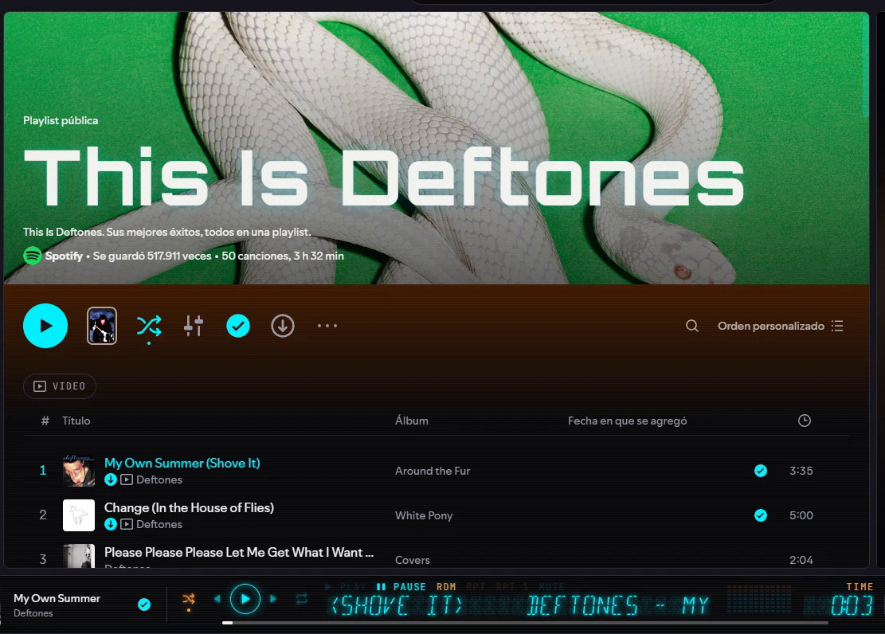

# NEON//VFD

> **EN:** A Spicetify theme that turns Spotify's playback bar into a 2000s car
> stereo **VFD display**: 16-segment text with ghost segments and marquee, PLAY /
> RDM / RPT indicators, and controls built into the panel. Japanese, Korean and
> other non-Latin scripts switch to a **dot-matrix** display; Cyrillic stays in
> 16 segments. Dark charcoal + cyan neon that lights up only on what's active.

Tema de [Spicetify](https://spicetify.app) que convierte la barra de
reproducción de Spotify en el **display VFD de un autoestéreo de los 2000**, y
lleva ese estilo a todo Spotify: negro carbón con neón cian que se enciende solo
en lo activo.



## Qué hace

- **Display de 16 segmentos** con artista y título: segmentos apagados visibles
  como "fantasma", marquesina que avanza de carácter en carácter, y el texto se
  ajusta al ancho de la ventana.
- **Indicadores** PLAY / PAUSE / RDM / RPT / RPT 1 / MUTE, tiempo transcurrido
  o restante (clic) y un medidor de 12 barras.
- **Controles dentro del display:** aleatorio, anterior, play/pausa, siguiente y
  repetir; toda la barra de abajo es un solo panel VFD.
- **Kanji, kana y hangul** pasan solos a **matriz de puntos** (con las fuentes
  de Windows: Yu Gothic, Malgun Gothic, Microsoft YaHei). **El cirílico** se
  queda en 16 segmentos, con glifos propios, como en el tubo soviético ИВ-17.
- **Todo el tema:** paneles oscuros con borde tenue, chips, cards, buscador e
  íconos que se encienden en cian al pasar el mouse o al estar activos.
- **Spicy Lyrics:** si usas esa extensión, su fondo de colores se oscurece y la
  línea que se canta brilla en cian.

### Animaciones

Se mueven **siempre** por defecto. En el **menú de perfil de Spotify →
"NEON//VFD · Animaciones"** cada clic pasa a Seguir a Windows → Nunca → Siempre.

### El medidor

Spotify no deja leer el audio (viene cifrado), así que el medidor usa el
análisis que Spotify hace de cada canción (`Spicetify.getAudioData`). En algunas
versiones de Spotify ese análisis no responde: entonces el medidor se atenúa en
vez de inventar movimiento.

## Instalar

### Desde el Marketplace de Spicetify

Busca **NEON//VFD** en la pestaña de temas del Marketplace e instálalo.

### A mano (Windows)

Requiere Spicetify y Node.js.

```powershell
git clone https://github.com/pdrccx/spicetify-neon-vfd
cd spicetify-neon-vfd
powershell -ExecutionPolicy Bypass -File .\install.ps1
```

Arma el tema, guarda tu tema actual, lo copia a `%APPDATA%\spicetify\Themes\NeonVFD`
y corre `spicetify apply` (**reinicia Spotify**). Para quitarlo y regresar al
tema que tenías:

```powershell
powershell -ExecutionPolicy Bypass -File .\uninstall.ps1
```

## Compatibilidad

Probado en **Spotify 1.3.3** con **Spicetify 2.45**. En esa versión casi todo
`Spicetify.Player` falla; el tema lo detecta y usa el estado interno de Spotify.
Spotify cambia sus nombres internos con las actualizaciones: si algo deja de
verse bien, abre un issue con tu versión de Spotify.

## Desarrollo

| Archivo | Qué es |
|---|---|
| `src/color.ini` | Paleta (se copia tal cual) |
| `src/user.css` | Estilos; `build.mjs` le incrusta las fuentes |
| `src/theme.js` | Display, controles, indicadores y medidor |
| `src/segment16.js` | Motor de glifos de 16 segmentos (latín, cirílico, signos) |
| `src/dotmatrix.js` | Matriz de puntos para kanji, kana, hangul y otras escrituras |
| `fonts/` | Orbitron, Inter y JetBrains Mono (subconjunto latino) y sus licencias |
| `build.mjs` | Arma `NeonVFD/` |
| `test/check.mjs` | Prueba el tema en una página que imita a Spotify (necesita Electron) |

```powershell
node build.mjs
$env:ELECTRON = "ruta\a\electron.exe"; node test/check.mjs
```

## Créditos y licencias

- Código bajo licencia [MIT](LICENSE).
- Diseño: estilo NEON//VFD del Cordero Design System, de Pedro.
- Fuentes bajo la [SIL Open Font License 1.1](fonts/LICENSE-Orbitron.txt):
  [Orbitron](https://github.com/theleagueof/orbitron),
  [Inter](https://github.com/rsms/inter) y
  [JetBrains Mono](https://github.com/JetBrains/JetBrainsMono).
- Modificar el cliente de Spotify técnicamente va contra sus términos de uso.
